# symbion


A notebook and ticket registry for one project, shared by you and your coding
agent. Bugs, tasks, decisions and verified results go in as dated entries, so
what a session learned is still there when the next one starts.

**[Live demo](https://symbion.nullphase.net/)**: the browser view of a real
project's notebook, read-only.



## What it does for you

- **Each session starts where the last one stopped.** A session-start hook
  gives the agent the open bugs, tasks and questions, the entries due soon, and
  the ones you wrote or answered. `/symbion:wrap` ends a session: the entries it
  owes, then a store commit whose message is the next session's handoff. You
  do not brief it again.
- **A result knows its age.** A `check` records what ran, what it said, and
  the commit it ran at. Once the code moves on, it reads `behind 12`, not
  "tests pass".
- **Questions go both ways.** The agent files a `question` for you. Your
  answer, from a terminal or the browser, reaches its next session.
- **Entries attach to things.** An entry sits on a commit, a file, a named item
  or the whole project, so `symbion context --target file:src/x.py` finds
  every entry on that file.
- **A trap shows up when it matters.** In Claude Code and Codex, an entry
  tagged `gotcha` on a file reaches the agent the first time it reads or edits
  that file, with its age and how many commits have changed the file since.
- **Checklists across a codebase.** An arc is a named line of work with one
  box per item: a file, a test, a host. `symbion arc reconcile` reports the
  boxes whose file was renamed or deleted.
- **Plain files you own.** The entries are JSONL in a git repo beside the
  project. There is no server, account or database. Checking out an old
  branch does not change your tickets.
- **A local web page, if you want one.** `symbion serve` opens on what waits
  on you, with one-click answers to the agent's questions; then boards, a
  peek at any entry beside the page (`j`/`k`), and search across every store
  you serve (`⌘K`). It installs as an app. [How symbion works](https://github.com/phreakocious/symbion/blob/main/src/symbion/data/help.md),
  its help page, explains the model for a person rather than an agent.

symbion works with Claude Code, Codex, Antigravity and Hermes Agent, and the
CLI works without any of them.

## How it compares

- **Claude Code's memory.** Keep it on: the two do different jobs. Memory
  keeps how to work, as facts and preferences Claude writes for itself on one
  machine. symbion keeps what is open. Each entry has an author and stays open
  until someone resolves it, and the store is a git repo you can push.
- **GitHub issues.** Use both: they do different jobs. Issues are the public
  layer, almost part of the code, and best kept clear of day-to-day detail.
  symbion takes that detail: what an agent found broken, decided, or needs to
  ask you. It keeps it out of the way, and hands it back when it matters: at
  session start, or when the agent opens the file a trap is on.
- **Memory tools.** symbion runs no model: no API key, no embeddings, no cost
  per write. Nothing leaves the machine until you push the store. It is a
  ticket queue the agent keeps, and each new session reads it first.

## Install

In Claude Code, from your project:

```
/plugin install symbion --marketplace phreakocious/symbion
/symbion:setup
```

`/symbion:setup` installs the `symbion` CLI, creates the project's store and
brings in its open threads: TODO files, handoff notes, Claude Code's memory. It
says what each step writes and where, and asks before the install and again
before it brings anything in. Then it starts the web page on your project's
notebook and gives you its address. The plugin carries no copy of the skill: its hooks and skill run the
installed CLI's own, so the two always match.

## Codex, Antigravity, Hermes Agent, or the CLI alone

Python 3.11+ and git. On Windows, use Git for Windows.

```bash
pipx install 'symbion[gui]'     # or: uv tool install --python '>=3.11' 'symbion[gui]'
```

`[gui]` adds the web page (`symbion serve`); leave it out for the CLI alone.
Run `command -v symbion` from another directory to check that it is on PATH:
the session-start hook finds `symbion` through PATH. Then, from your project's
root:

```bash
symbion init --agent codex          # lists each change and makes none (exit 1 if any)
symbion init --agent codex --yes    # creates the store, ../<repo>-notes, links the skill
```

`init --yes` registers Codex's hooks too when `$CODEX_HOME/hooks.json` does not
exist: one at session start, and one that gives the agent a file's `gotcha`
entries the first time it touches that file. When the file exists, `init` prints
each entry to add, or says the hook is already there. `symbion init --agent codex
--merge-hook` adds the entries for you and keeps the rest of the file.

A new store takes entries on a commit, an item, the project or an arc. For entries
on files, open `../<repo>-notes/symbion.toml` and uncomment `file =` under
`[catalogs]` and `file = "git"` under `[renames]`. A file target refused before
then names both lines.

Then add one line to `AGENTS.md`, and start a session:

```
- We use symbion for durable notes and tickets.
```

`--agent hermes` sets up Hermes Agent, which takes a line more: see the
[guide](https://github.com/phreakocious/symbion/blob/main/docs/guide.md#adopt-in-a-fresh-repo).

For Antigravity, install the CLI as above, then the plugin, and start a new
`agy` session after the same `AGENTS.md` line:

```bash
agy plugin install https://github.com/phreakocious/symbion/tree/main/plugin
symbion init --agent antigravity --yes   # the store: the plugin carries the skill and the hook
```

Antigravity loads no plugin commands, so `/symbion:setup` and `/symbion:wrap`
are Claude Code's alone, and it gets no gotcha hook.

## Docs

- [Guide](https://github.com/phreakocious/symbion/blob/main/docs/guide.md):
  install on each platform, TAB completion, adopting a repo with each agent,
  the first session, and the web page.
- [Reference](https://github.com/phreakocious/symbion/blob/main/docs/reference.md):
  kinds and arcs, catalogs, conventions, where things live, and development.
- [SKILL.md](https://github.com/phreakocious/symbion/blob/main/src/symbion/data/skill/SKILL.md):
  what the agent reads, with a table of the common commands. `symbion VERB -h`
  lists every flag of a verb.
- [Design](https://github.com/phreakocious/symbion/blob/main/docs/superpowers/specs/2026-09-04-symbion-design.md):
  why symbion is built as it is.

## Development

```bash
python3 -m venv .venv && .venv/bin/pip install -e '.[test,gui]'
.venv/bin/python -m pytest -q -n auto
```

Windows, and making a clone your installed symbion:
[Development](https://github.com/phreakocious/symbion/blob/main/docs/reference.md#development).
