<h1 align="center">symbion</h1>

<p align="center">
  <b>A notebook and ticket registry for one project, shared by you and your coding agent.</b><br>
  <sub>Bugs, tasks, decisions and verified results go in as dated entries, so what a session learned is still there when the next one starts.</sub>
</p>

<p align="center">
  
  <a href="https://pypi.org/project/symbion/"></a>
  <a href="https://github.com/phreakocious/symbion/blob/main/LICENSE"></a>
  <a href="https://github.com/phreakocious/symbion/blob/main/docs/guide.md#install"></a>
</p>

<p align="center">
  <b>Works with</b><br>
  <a href="https://github.com/phreakocious/symbion#install"></a>
  <a href="https://github.com/phreakocious/symbion#install"></a>
  <a href="https://github.com/phreakocious/symbion#install"></a>
  <a href="https://github.com/phreakocious/symbion#install"></a>
  <a href="https://github.com/phreakocious/symbion#install"></a>
  <br>
  <sub><b>full</b>: the open entries at session start, and a file's gotchas the first time the agent touches that file. The CLI works without any of them.</sub>
</p>

<p align="center">
  <a href="https://symbion.nullphase.net/" title="the browser view of a real project's notebook, read-only"><b>Live demo</b></a> ·
  <a href="https://github.com/phreakocious/symbion#install">Install</a> ·
  <a href="https://github.com/phreakocious/symbion/blob/main/docs/guide.md">Guide</a> ·
  <a href="https://github.com/phreakocious/symbion/blob/main/docs/reference.md">Reference</a> ·
  <a href="https://github.com/phreakocious/symbion/blob/main/src/symbion/data/skill/SKILL.md">SKILL.md</a> ·
  <a href="https://github.com/phreakocious/symbion/blob/main/docs/superpowers/specs/2026-09-04-symbion-design.md">Design</a>
</p>




## What it does for you

- **Each session starts where the last one stopped.** A session-start hook
  gives the agent the open bugs, tasks and questions, the entries due soon, and
  the ones you wrote or answered. `/symbion:wrap` ends a session: the entries it
  owes, then a store commit whose message is the next session's handoff. You
  do not brief it again.
- **A result knows its age.** A `check` records what ran, what it said, and
  the commit it ran at. Once the code moves on, it reads `behind 12`, not
  "tests pass".
- **Questions go both ways.** The agent files a `question` for you. Your
  answer, from a terminal or the browser, reaches its next session.
- **Entries attach to things.** An entry sits on a commit, a file, a named item
  or the whole project, so `symbion context --target file:src/x.py` finds
  every entry on that file.
- **A trap shows up when it matters.** In Claude Code, Codex, Pi and Hermes Agent, an entry
  tagged `gotcha` on a file reaches the agent the first time it reads or edits
  that file, with its age and how many commits have changed the file since.
- **Checklists across a codebase.** An arc is a named line of work with one
  box per item: a file, a test, a host. Give it phases (`symbion arc phases ID
  todo doing review`) and it is a board too: `arc move` moves a box, and in the
  browser you drag it. `symbion arc reconcile` reports the boxes whose file was
  renamed or deleted.
- **Plain files you own.** The entries are JSONL in a git repo beside the
  project. There is no server, account or database. Checking out an old
  branch does not change your tickets.
- **A local web page, if you want one.** `symbion serve` opens on what waits
  on you, with one-click answers to the agent's questions; then boards, a
  peek at any entry beside the page (`j`/`k`), and search across every store
  you serve (`⌘K`). It installs as an app. [How symbion works](https://github.com/phreakocious/symbion/blob/main/src/symbion/data/help.md),
  its help page, explains the model for a person rather than an agent.

## Install

> [!TIP]
> **Claude Code**, in a session in your project:
>
> ```
> /plugin install symbion --marketplace phreakocious/symbion
> /symbion:setup
> ```
>
> **Pi**, then `/symbion-setup` in a new `pi` session:
>
> ```bash
> pi install git:github.com/phreakocious/symbion
> ```
>
> **Antigravity**, then `/symbion:setup` in a new `agy` session:
>
> ```bash
> pipx install 'symbion[gui]'
> agy plugin install https://github.com/phreakocious/symbion/tree/main/plugin
> ```
>
> **Codex**, from your project's root, once `AGENTS.md` has the line
> `- We use symbion for durable notes and tickets.` Trust symbion's hooks at
> `/hooks` in the first session:
>
> ```bash
> pipx install 'symbion[gui]'
> symbion init --agent codex --yes
> codex --add-dir "../$(basename "$PWD")-notes"
> ```
>
> **Hermes Agent** 0.23.1 or later, then `/symbion:setup` in a new `hermes` session:
>
> ```bash
> hermes plugins install phreakocious/symbion#plugin --enable
> ```
>
> **The CLI alone**: `pipx install 'symbion[gui]'`, then `symbion init --yes` in
> your project.

The setup command installs the `symbion` CLI if it is missing, creates the
project's store and brings in its open threads: TODO files, handoff notes, an
agent's memory. It says what each step writes and where, and asks before the
install and again before it brings anything in. Then it starts the web page on
your project's notebook and gives you its address. The plugin carries no copy
of the skill: its hooks and skill run the installed CLI's own, so the two
always match.

The CLI needs Python 3.11 or later and git; on Windows, Git for Windows. After
a `pipx` install, run `command -v symbion` from another directory: the hooks
find `symbion` through PATH (under Hermes Agent, the gateway's). The
[guide](https://github.com/phreakocious/symbion/blob/main/docs/guide.md#install)
gives each agent's install in full, uv included.

## Upgrading

In Claude Code, turn on auto-update for the symbion marketplace (`/plugin`,
Marketplaces, symbion, Enable auto-update), or update the plugin in `/plugin`.
Then run `/reload-plugins` or start a new session. The CLI follows if uv or
pipx installed it. Everywhere else, run `uv tool upgrade symbion` or `pipx
upgrade symbion`, then `symbion serve --restart`. The
[guide](https://github.com/phreakocious/symbion/blob/main/docs/guide.md#upgrading)
says what the plugin's update runs.

## How it compares

- **Claude Code's memory.** Keep it on: the two do different jobs. Memory
  keeps how to work, as facts and preferences Claude writes for itself on one
  machine. symbion keeps what is open. Each entry has an author and stays open
  until someone resolves it, and the store is a git repo you can push.
- **GitHub issues.** Use both: they do different jobs. Issues are the public
  layer, almost part of the code, and best kept clear of day-to-day detail.
  symbion takes that detail: what an agent found broken, decided, or needs to
  ask you. It keeps it out of the way, and hands it back when it matters: at
  session start, or when the agent opens the file a trap is on.
- **Memory tools.** symbion runs no model: no API key, no embeddings, no cost
  per write. Nothing leaves the machine until you push the store. It is a
  ticket queue the agent keeps, and each new session reads it first.

## Docs

- [Guide](https://github.com/phreakocious/symbion/blob/main/docs/guide.md):
  install on each platform, TAB completion, adopting a repo with each agent,
  the first session, and the web page.
- [Reference](https://github.com/phreakocious/symbion/blob/main/docs/reference.md):
  kinds and arcs, catalogs, conventions, where things live, and development.
- [SKILL.md](https://github.com/phreakocious/symbion/blob/main/src/symbion/data/skill/SKILL.md):
  what the agent reads, with a table of the common commands. `symbion VERB -h`
  lists every flag of a verb.
- [Design](https://github.com/phreakocious/symbion/blob/main/docs/superpowers/specs/2026-09-04-symbion-design.md):
  why symbion is built as it is.

## Development

```bash
python3 -m venv .venv && .venv/bin/pip install -e '.[test,gui]'
.venv/bin/python -m pytest -q -n auto
```

Windows, and making a clone your installed symbion:
[Development](https://github.com/phreakocious/symbion/blob/main/docs/reference.md#development).
