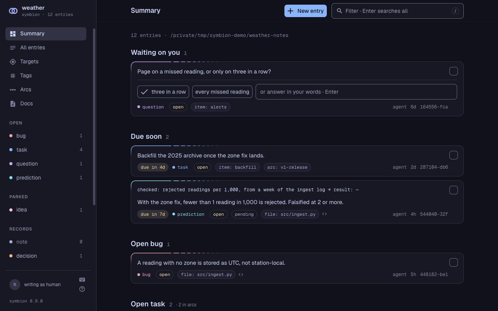

# symbion guide

Install symbion, adopt it in a repo, and run the first session. The
[README](../README.md) has the short version; the [reference](reference.md)
says how symbion behaves.

## Install

### In Claude Code

From the project, in Claude Code:

```
/plugin install symbion --marketplace phreakocious/symbion
/symbion:setup
```

The first line adds the repo as a marketplace (Claude Code asks `y` to add it,
then a scope) and installs the plugin, live in the same session. The plugin holds
setup and wrap commands, a stub skill and two small hooks, which also bring the
matching CLI after a plugin update (see Upgrading). The stub runs `symbion skill`,
and the hooks run the installed package's own `session_start.sh` and
`gotchas.sh`, so the skill and the hooks always match the CLI.

`/symbion:setup` then asks before each write, usually twice:

1. It checks for the CLI and the repo. Outside a git repository it stops. It
   lists what it would write: the CLI (`uv tool install --python '>=3.11'
   'symbion[gui]'`, or `pipx install 'symbion[gui]'`, or an upgrade), the store
   `../<repo>-notes` with its `symbion.toml` and `README.md`, and one line in
   `CLAUDE.md`. On your yes, it installs, runs `symbion init --yes` and writes
   the line.
2. It follows `adoption.md`: it reads the project's TODO files, handoff notes,
   Claude Code memory and git log, and shows a table of the entries it would make
   and the sources it would retire. On your yes, it writes them and commits the
   store. A retired file's `rm` is yours to run. A store that already has
   entries, from symbion installed before the plugin, say, gets asked first
   whether to look for what it lacks.

It ends by starting `symbion serve` and giving you the address. A project with
nothing to bring in gets the [live demo](https://symbion.nullphase.net/)'s link,
to see a store weeks in.

### Codex, Antigravity, Pi, Hermes Agent, or the CLI alone

Python 3.11+ and git. On Windows, use Git for Windows: catalogs and
resolvers run in its `sh`, which symbion finds beside git even when only
Git's `cmd` directory is on PATH. Claude Code runs the plugin's hooks in
Git's bash; without Git for Windows they fail with `'sh' is not recognized`.
Codex's hook runs in Windows PowerShell.

```bash
pipx install 'symbion[gui]'     # or: uv tool install --python '>=3.11' 'symbion[gui]'
# [gui] adds the web UI (symbion serve); drop it for the core alone.
# Unreleased main: pipx install 'symbion[gui] @ git+https://github.com/phreakocious/symbion'
```

uv picks its default Python unless told otherwise. On macOS that may be the
system's 3.9, which symbion's install refuses; `--python '>=3.11'` uses one
3.11 or later, and downloads one into uv's own directory if none is found.
pipx installs on its own Python, and on one older than 3.11 finds no symbion
("Requires-Python >=3.11"): `pipx environment --value PIPX_DEFAULT_PYTHON`
names it, and `--python PATH` installs on another.

The core's four dependencies serve a person at a terminal: `rich` and
`rich-argparse` colour and align the output (a pipe gets plain text),
`markdown-it-py` reads entry bodies, and `argcomplete` does TAB completion.

Run `command -v symbion` from another directory to check that it is on PATH.
The SessionStart hook finds `symbion` through PATH. Without it, the hook
prints one line in a project that adopted symbion, and nothing elsewhere:
`symbion: cannot read store at … because 'symbion' is not on PATH`.

**TAB completion.** Add your shell's line to its rc file:

```bash
eval "$(symbion completion zsh)"     # ~/.zshrc, after compinit
eval "$(symbion completion bash)"    # ~/.bashrc
symbion completion fish | source     # ~/.config/fish/config.fish
```

In zsh you can instead save the output as `_symbion` in a directory on
`$fpath` (oh-my-zsh: `$ZSH_CUSTOM/completions`). It stays out of a shared rc
file and loads on the first TAB, not at every shell start. Regenerate it after
an argcomplete upgrade.

TAB completes verbs, flags and the store's values: kinds, target types, the
`TYPE:NAME` targets its entries use, entry ids (only open ones for `resolve`), arc
ids and tags. zsh and fish describe each value. A `--dir` on the line picks
the store.

## Upgrading

In Claude Code, turn on auto-update for the symbion marketplace (`/plugin`,
Marketplaces, symbion, Enable auto-update), or update the plugin in `/plugin`.
Then run `/reload-plugins` or start a new session. The package follows: the
first tool call or session start after an update runs `uv tool upgrade symbion`
or `pipx upgrade symbion`, whichever installed it, and restarts any `symbion
serve`; on Windows the agent's line says to restart it by hand. An editable
install, or one not made by uv or pipx, is left alone, with a note to the agent.

Everywhere else, run `uv tool upgrade symbion` or `pipx upgrade symbion`, then
`symbion serve --restart`.

## Adopt in a fresh repo

From the repo's root:

**1. Create the store and link the agent files.** In Claude Code,
`/symbion:setup` runs this step and the bootstrap for you. By hand:

```bash
symbion init --agent codex          # lists each change and makes none (exit 1 if there are any)
symbion init --agent codex --yes    # makes them
```

`--agent hermes` sets up Hermes Agent, and `--agent both` is Codex and Claude
Code. On Claude Code the plugin carries the skill and the hooks, so `init` (its
default agent) makes only the store there. There, init names a
`~/.claude/skills/symbion` link or a symbion hook in `~/.claude/settings.json`
left from an install before the plugin: with both, each session gets the skill,
the summary and each gotcha twice. It says how to remove each, and removes
neither. `--agent antigravity` makes only the
store too, and prints the plugin's install line until `agy` has the plugin:

```bash
agy plugin install https://github.com/phreakocious/symbion/tree/main/plugin
```

agy copies the plugin into `~/.gemini/config/plugins/symbion` and finds it at its
next start. An upgrade of symbion leaves that copy as it was: `init --agent
antigravity` names a copy whose version is not symbion's, and the command that
updates it. The copy holds the stub skill, the setup and wrap skills
(`/symbion:setup` and `/symbion:wrap`), and the session-start hook. agy has no
gotcha hook. The hook runs in `sh`; on Windows that is untested.

`--agent pi` makes only the store as well, and prints the Pi package's install
line until Pi's `settings.json` lists it:

```bash
pi install git:github.com/phreakocious/symbion
```

Pi clones the repo and loads `plugin/pi/symbion.ts` from it at its next start.
The extension runs the plugin's two hooks: the summary at session start and
after each compaction, and the gotcha line on the results of `read`, `edit`,
`write` and `bash`. It adds the installed CLI's skill as `/skill:symbion`, and
the commands `/symbion-setup` and `/symbion-wrap`. After setup installs the
CLI, run `/reload` so Pi loads the skill. The hooks run in `sh`; on Windows
that is untested. To try it with a local model, add an Ollama provider to
`~/.pi/agent/models.json`, as Pi's `docs/models.md` shows. Without a large GPU,
Ollama serves a 4k context (`ollama ps` shows it), far less than Pi assumes, and
drops what does not fit without an error, the summary included. Start `ollama
serve` with `OLLAMA_CONTEXT_LENGTH` raised, and set the model's `contextWindow`
in `models.json` to match.

This creates `../<repo>-notes`, a git repo with no remote, holding a commented
`symbion.toml` whose every value has a default and a README.md that says what
the store is. Out of the box an entry goes on a commit, an item, a file, the
project or an arc. In a store made before 0.14, uncomment `file =` under
`[catalogs]` and `file = "git"` under `[renames]` for entries on files; a file
target refused before then names both lines, by number.

In Claude Code the plugin's hooks run the installed package's scripts. At each
session start the hook gives the agent `symbion summary` and shows you one line of it: the open counts, the soonest due
entry and, while `symbion serve` runs, its address. The gotcha hook runs
`gotchas.sh` after each Read, Edit, Write, NotebookEdit and Bash call, failed
calls included (a Bash command that exits non-zero is one): the first time a
session's call names a file that an entry tagged `gotcha` is on, a symbion
command aside, and again the first time it edits that file, the agent
gets that entry's lead, its age, how many commits have changed the file since,
and the command that retires it: a gotcha has no status, and the agent in
the file is the one placed to judge whether it still holds. At the edit, an
entry the agent already got in full comes back as one line of ids, with the
`symbion show` command that prints them: the hook answers after the edit. It reads a list
the session-start hook writes under
`~/.cache/symbion/gotchas/`, and the package's directory from
`~/.cache/symbion/skill_dir`, which the plugin's session-start hook writes from
`symbion skill --path` when it is missing or stale. So it costs a few
milliseconds and never runs `symbion`. A gotcha written after a session starts,
by you or by another session, reaches it at its next start, resume, `/clear` or
compaction. The plugin's skill is `symbion:symbion`: its stub runs `symbion
skill`, which prints the installed skill with this store's kinds in it.

For Codex, `init --agent codex` links `~/.agents/skills/symbion` to the same
skill directory and registers SessionStart and PreToolUse hooks in `$CODEX_HOME/hooks.json`
(default `~/.codex/hooks.json`), on the same terms: it writes that file only
when it is absent or under `--merge-hook`, and counts a registration inline in
`config.toml`. Codex skips a new hook until you trust it in `/hooks`. See the
[Codex hook documentation](https://learn.chatgpt.com/docs/hooks). On macOS and
Linux the command runs `session_start.sh`. On Windows, init adds a
`commandWindows` override running `session_start.ps1` with Windows PowerShell,
without loading a profile. WSL is not required. Both commands read the
session's cwd and use `codex` as the reader unless `SYMBION_AUTHOR` overrides it.
The PreToolUse hook runs `codex_gotchas.py` with the Python interpreter that
installed symbion, on all platforms. It reads the same session cache and shows
gotchas before a tool call first names their file, and again before its first
edit. For `apply_patch`, it checks only file headers, including move destinations.
Existing installations can add it with `symbion init --agent codex --merge-hook`,
then review it in `/hooks`. With hooks inline in `config.toml`, init prints the
TOML to append there instead. A `~/.agents/skills/symbion` that is not the link
is left alone and named, and init registers no hook until it is moved aside:
each hook runs its script through that path. On Windows the link is a
directory junction when the account cannot make a symlink, so neither
Developer Mode nor an elevated terminal is needed.

**Give Codex access to the store.** Codex's sandbox writes only inside the
project, and the store sits beside it. Launch `codex --add-dir
../<repo>-notes`, or add the store to `sandbox_workspace_write.writable_roots`
in Codex's `config.toml`; `init` prints the path. A `.symbion` pointer grants
no access, and `symbion commit` may still ask for approval. A linked worktree
uses the main checkout's store, so grant that one.

**Give Antigravity access to the store.** In agy's default mode, shell calls
run outside its sandbox and reach the store, each after your approval unless
you allowed it. In auto mode, calls run in the sandbox, which reads only the
workspace and system directories: symbion's install and the store are outside
it, so `symbion` does not start there. `symbion init --agent antigravity`
prints the permission rules that fix this: a `read_file` rule for each
directory symbion runs from, and a `write_file` rule for the store, which also
lets `symbion commit` run in the sandbox. Add each at agy's `/permissions`
(press A, Global scope) exactly as printed. `/symbion:setup` asks for them before
it makes the store: a rule may name a directory that does not exist yet. agy refuses a rule with `~`, and
then runs no sandboxed command at all. agy 1.4.12 drops `--mode auto` at
startup, so switch to auto in the session.

For Hermes Agent, `init --agent hermes` links `$HERMES_HOME/skills/symbion`
(default `~/.hermes/skills/symbion`), where Hermes finds it with no change to
its config. A named profile has its own `HERMES_HOME`: run `init --agent
hermes` again with it set. An install before this one linked `~/.agents/skills`
and listed it under `skills.external_dirs`; that still works beside the new
link. init also prints the plugin's install line until
`$HERMES_HOME/plugins/symbion` holds it:

```bash
hermes plugins install phreakocious/symbion#plugin --enable
```

The plugin needs Hermes 0.23.1 or later. Hermes clones the repo's `plugin/` directory and loads `plugin/__init__.py`
from it. The plugin runs the same two hooks: the summary on a session's first
turn, after a resume and after a compaction that rewrites the history, and the
gotcha line on the results of `terminal`, `read_file`, `write_file` and
`patch`. A `delegate_task` subagent gets the gotchas but no summary, and its
writes count as its parent session's. The plugin offers its setup and wrap
skills as `/symbion:setup` and `/symbion:wrap`, and the installed CLI's skill as
`symbion:symbion`. Its hooks run in Hermes's gateway, so `symbion` must be on the
gateway's PATH, not only your shell's: Hermes's terminal reads a login shell's PATH,
and the gateway keeps the one it started with. When the gateway finds no `symbion`,
the session-start line names its PATH. From a shell where `symbion -V` works, run
`hermes gateway install --force` for a gateway service, else `hermes gateway stop`:
the next chat starts it again with that shell's PATH. On Windows it is untested. Without the
plugin, a line in the project's `AGENTS.md` asks for the summary (step 3).
Hermes's default local terminal writes to the store beside the project with
no further setup.

The only file `init` writes into the project is a `.symbion` pointer, when the
store is not the default sibling. It marks the pointer `(git: ignored)` or
`(git: not ignored)`; a not-ignored one goes in with your next `git add -A`.
The hook runs in every project and says nothing where there is no store.

**2. Check the read side.** Start a session, or run the hook by hand:

```bash
CLAUDE_PROJECT_DIR=$PWD sh "$(symbion skill --path)/session_start.sh"   # what the plugin's hook runs
sh ~/.agents/skills/symbion/session_start.sh     # the same, through Codex's link
```

For Codex on Windows, run this from the project in PowerShell:

```powershell
powershell.exe -NoProfile -NonInteractive -ExecutionPolicy Bypass -File "$HOME\.agents\skills\symbion\session_start.ps1"
```

agy runs its hook in the plugin's directory and names the project on stdin.
By hand, from the project:

```bash
printf '{"workspacePaths":["%s"]}' "$PWD" | ANTIGRAVITY_CONVERSATION_ID=by-hand \
  sh ~/.gemini/config/plugins/symbion/hooks/session_start.sh antigravity
```

It prints `{"injectSteps": [{"systemMessage": {"systemMessage": …}}]}`, and the
text in the table below is that inner `systemMessage`, which the model reads.

Hermes Agent's plugin runs this same hook. Without the plugin, start a session
after step 3: its first command should be `symbion summary`.

`session_start.sh` prints one JSON line: the text in the table below is its
`additionalContext`, what the agent reads, and its `systemMessage` is what you
see at session start: one line, and in a [shared store](#share-a-store) above it
the pull's lines that say `symbion.toml` changed, with the command that shows
the change, or that a clone runs an older symbion, and, until you run
`symbion trust`, the line that says writes wait on it. The not-on-PATH line and the `error:` lines
print as plain text, and the PowerShell hook prints all of it that way.

| output | meaning |
|---|---|
| `symbion: open outside arcs: bug 0, task 0, question 0, prediction 0` (`; N open in arcs` when arcs hold any, `; N parked` when any open entry is parked), then a line per arc and the open entries | working |
| `symbion --dir ../other-notes: open outside arcs: …` | working, on a store this repo's tree does not name (`--dir`, `SYMBION_DIR`, or a cwd inside a store); the header names it, so two summaries in one session can be told apart |
| either, then `  N entries not yet in the store's git (symbion commit)` | working; `/symbion:wrap` at session end commits them |
| either, then `… (symbion commit --all once their session has ended, the newest written 2h ago)` | the entries are another session's, and `symbion commit` takes only yours: `--all` takes them once that session has ended. The age is the only clue to whether it has: an idle session that is still open writes nothing either |
| `symbion: cannot read store at … because 'symbion' is not on PATH` | see [Install](#install) |
| `symbion: this project has a symbion store, but the symbion CLI is not installed or does not run: run /symbion:setup.` | the plugin's hook, with no `symbion` that runs: `/symbion:setup` installs it. In Antigravity the line ends `see Install at https://github.com/phreakocious/symbion`, and in Pi `run /symbion-setup.` In Hermes Agent with no `symbion` on the gateway's PATH, it names that PATH and the `hermes gateway` command that restarts the gateway with yours |
| `symbion: no store at …; run \`symbion init\`` | no store yet, or `.symbion`/`SYMBION_DIR` names a missing path |
| `error: …/.symbion is a link to …` or `error: cannot read …/.symbion` | `.symbion` is there but is not a file symbion can read; the message gives the fix |
| nothing | no store, no `.symbion` and no `SYMBION_DIR`, or the plugin is not installed (Claude Code, Antigravity, Hermes Agent), or the hook is not registered or not trusted (Codex) |

**3. Tell the agent.** One line in `CLAUDE.md` (Claude Code) or `AGENTS.md`
(Codex, Antigravity), and for Hermes Agent in the first of `.hermes.md`,
`AGENTS.override.md`, `AGENTS.md` and `CLAUDE.md` it finds, else a new `AGENTS.md`:

```
- We use symbion for durable notes and tickets.
```

Without its plugin, Hermes Agent runs no hook and needs a second line. Hermes reads only the
first of `.hermes.md`, `AGENTS.override.md`, `AGENTS.md` and `CLAUDE.md` it
finds in the project, so put the line in that file:

```
- At the start of a session, run `symbion summary` unless a hook already printed it.
```

If that instruction file is gitignored, or someone reviews every change to it,
propose the line to the user instead of writing it.

**Several repos that change together.** Make one store, list the repos under
`[repos]` in its `symbion.toml`, and run `symbion --dir ../<store> init --yes`
in each repo, which writes its `.symbion`. `catalogs.md`, "Repos", has the
table and how to convert a store that already exists.

## First session

A repo with history (known issues, TODOs, docs, a handoff file) starts with
`adoption.md`, installed beside `SKILL.md`. It says which catalogs to turn on
and what to bring in; its entries go in as one `symbion add --from-json -`,
validated together before any is written. Either way:

**The first entry is a check, written now:** the state the store began at,
which no commit message records. It pays first: dated, re-checkable, and
visibly stale once HEAD moves. A check stamps HEAD and whether the tree is
dirty, untracked files included. Until step 3's line is committed, the tree is
dirty and the check reads `unverifiable (dirty tree)`. Commit, write it again,
and it reads `current`. Files the checked command writes count too, so git-ignore
`__pycache__/` before checking `pytest`. A check on something outside the repo
(DNS, a host) takes `--external` and shows its age instead.

```bash
symbion add check --target commit:HEAD --checked "pytest -q" --result "147 passed"
symbion list --kind check    # unverifiable when dirty, current when clean, behind N once HEAD moves
```

**The first checklist is an arc over free-form items.** `add` each item with a
body. `seed` mints one bodiless task per name and is for fanning out over a
[catalog](reference.md#catalogs-when-a-homogeneous-set-exists).

```bash
aid=$(symbion arc create --name "Adoption" --scope item --desc "Usable by someone who was not in the room.")
symbion add task --target "item:write the README" --arc-id "$aid" --body "Done: a stranger can install and record an entry."
symbion arc todo "$aid" --json      # open items
symbion resolve <id>                # tick one: <id> reads resolved, its open version kept under a new id
symbion arc list                    # done/total per arc
symbion list --arc "$aid" --json    # every item, resolved included
```

**An arc is a board too.** `arc phases` names its columns, left to right.
Each open box sits in one column, and the resolved boxes sit in done. `arc
move` moves a box, and `arc todo` lists the open boxes in board order:

```bash
symbion arc phases "$aid" todo doing review   # no names clears them
symbion arc move <id> --phase doing           # --top, --before ID or --after ID place it in its column
```

**End a session with `/symbion:wrap`.** Writes never commit, so a git failure
never blocks an entry; `symbion summary` shows the uncommitted count until a
commit. The wrap (`wrap.md` in the skill) files an open `question` for each ask
the user left unanswered, writes entries for what the session learned, changed
and finished, then commits the store with the next session's handoff as its
message:

```bash
symbion commit --wrap -m "adoption: README ticket closed, the guide is next

Closed 412907-3be with the README a stranger can install from. The guide's
install section is still the pip line alone."
symbion push         # when the store has a remote
```

The next session's summary prints that message as `last wrap by …`, with its
age and the repo commits since: the handoff lives in the store's git log, not
in a file. A plain `symbion commit -m` commits without marking a session end.

`commit` says `no remote` while the store has none. A store kept on one disk on
purpose takes `local_only = true` in its `symbion.toml`, and `commit` stops saying so.
With nothing to commit, `commit` exits 1, as git does, so a script's `symbion commit
&& symbion push` stops on a clean store. `commit --wrap` commits its message alone
then, so a session that changed only the repo still leaves its handoff. The first `commit` also takes the files
`init` wrote (`.gitignore`, `README.md`, `symbion.toml`): `init` commits nothing.

`commit` takes your entries: in an agent session (Claude Code, Codex, Antigravity, Pi, Hermes Agent),
the ones that session wrote; at a plain terminal, your author's. Two sessions on one store each commit
their own. It names the entries it left and the newest one's age, and `commit --all`
takes them too, for a session that ended without committing. From another project's
tree, as with `--dir ../other-notes`, it takes no file but the new docs your entries
name: the store's other changed files are its own project's work, and it names them.
A line the last commit holds that is gone from `notes.jsonl`, with no copy an edit
kept under a new id (a hand edit, a repair), is no session's: `commit` and its dry
run name it, and only `commit --all` takes the removal.

## Share a store

Two people, each with their own agents, can keep one store: one git remote and a
clone for each person. Each person's session start reads their own side's entries,
and one line says the other side wrote something. The other side's entries arrive
at a pull, which session start and `commit` run for you.

Shared stores are experimental. A later release may change them, or remove them.

**1. Upgrade symbion** on every machine that holds a clone, first. A symbion from
before shared stores gives an edit the wrong side.

**2. Switch it on.** The store needs a remote, and the clone needs a `user.name`:
that name is the side, so each person's must differ. The store commits as the
clone's git identity, so the clone needs a `user.email` too, unless git has a
global one. In the first person's clone:

```bash
git -C ../<repo>-notes remote add origin <url>      # if the store has no remote yet
git -C ../<repo>-notes config user.name "First Person"
git -C ../<repo>-notes config user.email first@example.com
```

Then add `shared = true` to `../<repo>-notes/symbion.toml`, at the top of the file,
above the first `[table]` header, under `default_branch` if the file has one:

```toml
default_branch = "main"
shared = true
```

A key below a header belongs to that table: the file `init` writes ends inside
`[kinds]`, so a line added at its end breaks the store. Then commit, which in a
shared store also pulls and pushes:

```bash
symbion commit -m "store: shared"
```

**3. The second person clones the store** beside their checkout of the project,
where symbion looks for it (`../<repo>-notes`), and names their side in the clone:

```bash
git clone <url> ../<repo>-notes
git -C ../<repo>-notes config user.name "Second Person"
git -C ../<repo>-notes config user.email second@example.com
git -C ../<repo>-notes fetch
```

The clone brings the `symbion.toml` of the first person, whose commands symbion
runs: read it first. Run the `fetch` once by hand, on each machine. Session start
fetches with no terminal, so an unknown ssh host key, or a passphrase with no
agent, fails there rather than asking.

From then on session start pulls, and `commit` pulls, then pushes. Run `pull` or
`push` yourself when a line asks: `add`, `resolve` and `supersede` say `origin has N
new store commits: symbion pull`, and a `commit` that could not reach origin says
to pull, then push. A pull that cannot finish (a conflict in `symbion.toml` or in
a file under `docs/`) prints the git commands that end it.

A pull that changes `symbion.toml` stops every write, and every command the file
names, until you read the change and accept it at a terminal:

```bash
symbion trust
```

Reads go on, each with a line that says so, and so does session start. From an
agent's shell `trust` refuses: the agent shows you the change and asks you to run
it.
[The reference](reference.md#shared-stores) has the rest.

## Browse it (optional)

```bash
symbion serve        # the one command that needs the gui extra
```



A local page on a port of the store's own, the same at every restart, so a link
to an entry stays good (`serve` prints it, and `--port` picks another). It has:

- a Summary page: what waits on you (a question someone else wrote last, or
  your own entry someone else answered), the last wrap's handoff, and what
  is due, then boards by kind. Each entry shows once;
- a peek: a click on an entry's words opens it beside the page, whole, with
  its earlier versions; `j`/`k` move to the next or previous entry, and in
  the peek `x` resolves, `s` stars, `e` edits, `a` answers, `o` opens its
  page. A click with a modifier opens the entry's page in a new tab;
- answers on a question someone else wrote last: a button for each answer
  the asker gave with `--option`, the default first, and a field for your
  own words. The answer goes below the question, as you, and the question
  stays open for its asker to act on;
- boards by target on the targets page;
- a commit's page: its message, and each file it changed with the entries
  on that file;
- a commit's diff, unified or side by side, from its page or the button
  beside its chip, and, once a remote branch holds it, links to it on
  GitHub, GitLab, Codeberg, Bitbucket or sourcehut, and on GitHub to its
  pull requests;
- the commits behind a card's `N commits since` or `behind N`, and what they
  changed, a click away;
- a Docs page: every file in the store's `docs/` an entry is on, of any
  type, and every markdown file of the project's an entry is on or points
  at, the most named first, each with its
  entries, the open ones among them, and a button that opens it;
- a Map page: the store's entries as a treemap, grouped on up to three axes
  (target, tag, kind, status, author, arc, week written). A tile's area is its
  entries, its colour its open ones; a click lists a tile's entries, a click on
  a group fills the map with it and back undoes that, and every
  choice is in the URL. Enter in the search box maps only the entries the
  words find;
- the sidebar's kinds, each with what it is for when hovered: the `when`
  the store's `symbion.toml` gives it;
- an entry list where every tag, kind, author and target is a filter link;
- a search box (`/`): its text filters the page as you type, and Enter
  searches the whole store (every word, literally, in any case, a phrase in
  double quotes as one word, or a pasted entry id), as a pause in the typing
  does on a page of entries once none of them matches;
- a palette (`⌘K`, or `Ctrl K`): the places, the top bar's actions, and
  entries by words or by an id's tail, here first, then a count and a link
  for every other store a `serve` runs on. Enter peeks at an entry here, and
  `⌘`/`Ctrl` Enter opens a row's page in a new tab;
- a new entry from any page (`n`), on that page's object or any other: `#tag`
  and `!kind` in its body set its tags and kind, and Shift Enter adds it and
  starts the next;
- a file dropped on any page starts an entry: a file a catalog lists (the
  project's, or the store's `docs/`) is its target, other text its body
  (anything but markdown as a block of code, so its `#` and `!` words stay
  text), and text over 2,000 characters can be saved to the store's `docs/`
  with the entry pointing at it. With an entry open, the file joins its refs,
  or its text goes in at the cursor;
- a page per note: a rule in its body marks each amendment that joined it at
  a line break, with who added it and when, and its earlier versions show an
  edit as a diff; a tag index;
- an arc's page, as a checklist you tick or as a board: drag a box to another
  column or along one, or move it with its arrows. A drop on done resolves the
  box, and a drag out of done reopens it. Edit arc sets the columns;
- commit and push buttons, shown while there is something to commit or push.
  The commit button takes the entries written as you, the new `docs/` files
  they name and every arc change, so an agent's pending entries stay for it
  to commit. In a shared store both buttons pull, then push, as `commit`
  does at a terminal. Discard, beside commit, throws away what the commit
  would take for you, after a list; the undo arrow brings it back;
- a button with a count, shown when an entry was written or edited after the
  page was drawn: by an agent, at a terminal, or in another tab. The page does
  not redraw by itself. The button lists those entries beside the page, with
  a reload at the top. In the installed app, the icon's badge counts the
  entries others wrote since you last opened a page.

Chrome and Edge can install the page as an app (the install icon in the
address bar). Each store is an app of its own, because each has its own port.
With tabbed mode, its pages open as tabs in one app window, each tab named by
its page alone. On a desktop,
tabbed mode is behind `chrome://flags/#enable-desktop-pwas-tab-strip`; without
it, the app opens in a plain window. An app installed from an older symbion,
which served no manifest, stays a plain window: remove it and install it again.
The app's window has no status bar, so the address of the link under the
pointer shows at its bottom left.

Chrome opens a link to the app's pages in the app only when the link is
clicked inside Chrome. A link from another program, such as a terminal or a
mail client, opens in a browser tab with an **Open in app** button (Chromium
issue 330282442). On macOS, a URL router set as the default browser can send
those links to the app, but not as they are: the app's shim keeps only a link
whose scheme the app registers, and drops an `http:` one, so the app opens on
its start page. The app registers `web+symbion:`, and its `/go` page turns
such a link back into the page it names. With
[Finicky](https://github.com/johnste/finicky), `~/.finicky.js` names the
store's address, the app as it is named in `~/Applications/Chrome
Apps.localized/`, and the rewrite:

```js
export default {
  defaultBrowser: "Google Chrome",
  rewrite: [{
    match: "http://127.0.0.1:PORT/*",
    // a new string: the URL's protocol setter keeps http:
    url: (url) => url.href.replace(/^http:/, "web+symbion:"),
  }],
  handlers: [{
    match: "web+symbion://127.0.0.1:PORT/*",
    browser: "STORE · symbion",
  }],
};
```

The first such link asks, once, whether the app may open `web+symbion` links.
An app installed before symbion registered the scheme learns it when Chrome
next updates the app: close its windows and open it again.

`?` lists the keys. It writes as **you**: `SYMBION_AUTHOR`, else the store's
git `user.name`, shown at the foot of the sidebar, or in the top bar on a window
too narrow for one. `--author NAME` overrides.

It listens on 127.0.0.1, for this machine only, and answers only at `localhost`
or an IP address: any other name in the address bar gets a 403, because a web
page reaches a local server under a name of its own. To browse it from another
machine, `--host 0.0.0.0` listens on every address and `--allow` names who may
connect, an address or a network, once each: `symbion serve --host 0.0.0.0
--allow 192.168.1.0/24`. This machine always may, and `serve` refuses a `--host`
past loopback with no `--allow`. There is no login: every machine allowed writes
as the serve's author. `--read-only` serves a public demo: every control answers
with a notice, and nothing writes. Its links to GitHub go through the serve's
`/go/github?from=LINK`, a redirect, so the access log of a proxy in front of it
counts each click out and names the link.

One `serve` per store: run it in each project, and each one's sidebar links
the other stores a `serve` is running on, on this machine. Each running
`serve` keeps a small record in `~/.cache/symbion/serve/` (or under
`$XDG_CACHE_HOME`). A second `serve` on one store warns: the sidebars link the
first until it stops, then the second. While a `serve` runs on a store, each id
that `list`, `show` and `context` print at a terminal links to its entry's page
(cmd-click in iTerm2), and `summary` names the URL.

A running `serve` keeps the symbion it started with, and the `symbion.toml`
it read: a new kind or catalog type shows after a restart. After an upgrade or
a `symbion.toml` edit, `symbion serve --restart`, run from anywhere, restarts
every one in place: in its own terminal, on its own port, and its open tabs
reload. It prints the version each now runs, or in a checkout the commit, and
ends with a count (`restarted 3 of 3 serves`). `--stop` stops them all.
Neither works on Windows: there, Ctrl-C each one and start it again.
`symbion serve --list`, from anywhere and on Windows too, prints each running
serve's store, URL, pid, and the commit or version it runs.
