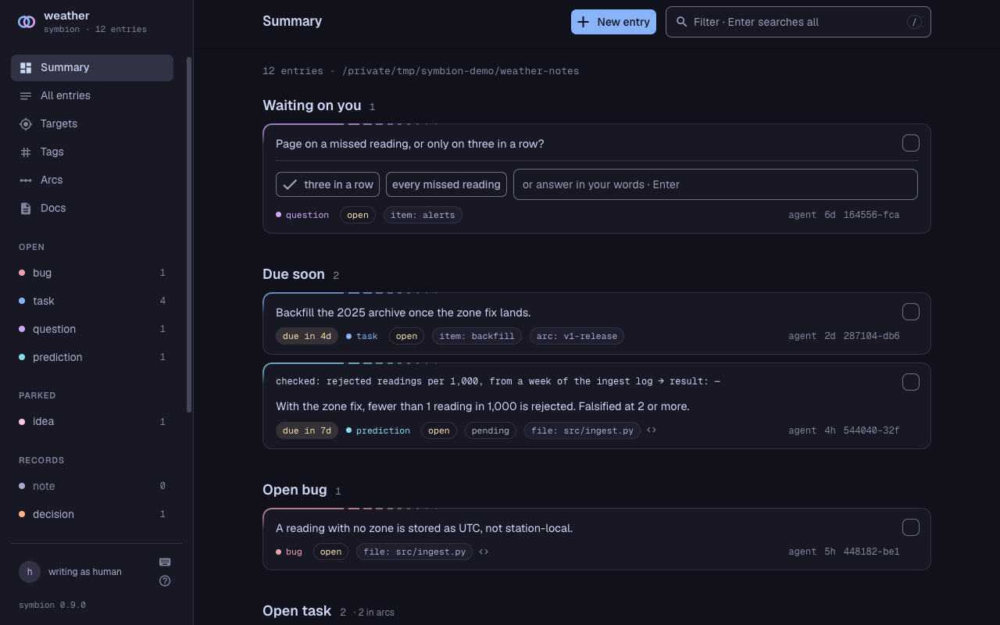

# symbion guide

Install symbion, adopt it in a repo, and run the first session. The
[README](../README.md) has the short version; the [reference](reference.md)
says how symbion behaves.

## Install

Python 3.11+ and git. On Windows, use Git for Windows: catalogs and
resolvers run in its `sh`, which symbion finds beside git even when only
Git's `cmd` directory is on PATH. Claude Code runs the session-start hook in
Git's bash; without Git for Windows it fails with `'sh' is not recognized`.
Codex's hook runs in Windows PowerShell.

```bash
pipx install 'symbion[gui]'     # or: uv tool install 'symbion[gui]'
# [gui] adds the web UI (symbion serve); drop it for the core alone.
# Unreleased main: pipx install 'symbion[gui] @ git+https://github.com/phreakocious/symbion'
```

The core's four dependencies serve a person at a terminal: `rich` and
`rich-argparse` colour and align the output (a pipe gets plain text),
`markdown-it-py` reads entry bodies, and `argcomplete` does TAB completion.

Run `command -v symbion` from another directory to check that it is on PATH.
The SessionStart hook finds `symbion` through PATH. Without it, the hook
prints one line in a project that adopted symbion, and nothing elsewhere:
`symbion: cannot read store at … because 'symbion' is not on PATH`.

**TAB completion.** Add your shell's line to its rc file:

```bash
eval "$(symbion completion zsh)"     # ~/.zshrc, after compinit
eval "$(symbion completion bash)"    # ~/.bashrc
symbion completion fish | source     # ~/.config/fish/config.fish
```

In zsh you can instead save the output as `_symbion` in a directory on
`$fpath` (oh-my-zsh: `$ZSH_CUSTOM/completions`). It stays out of a shared rc
file and loads on the first TAB, not at every shell start. Regenerate it after
an argcomplete upgrade.

TAB completes verbs, flags and the store's values: kinds, target types, the
`TYPE:NAME` targets its entries use, entry ids (only open ones for `resolve`), arc
ids and tags. zsh and fish describe each value. A `--dir` on the line picks
the store.

## Adopt in a fresh repo

From the repo's root:

**1. Create the store and link the agent files.**

```bash
symbion init          # lists each change and makes none (exit 1 if there are any)
symbion init --yes    # makes them
```

That sets up Claude Code; `--agent codex` sets up Codex instead,
`--agent both` sets up both, and `--agent hermes` sets up Hermes Agent.

This creates `../<repo>-notes`, a git repo with no remote, holding a commented
`symbion.toml` whose every value has a default and a README.md that says what
the store is. Out of the box an entry goes on a commit, an item, the project or
an arc. For entries on files, uncomment `file =` under `[catalogs]` and `file =
"git"` under `[renames]`; a file target refused before then names both lines,
by number. For Claude Code, the first
`init` on a machine also links `~/.claude/skills/symbion` to the skill directory in the installed
package (SKILL.md, adoption.md, catalogs.md and the hook scripts), so an upgrade
reaches every project. It registers its hooks in `~/.claude/settings.json` when
that file does not exist: the session-start hook, and the gotcha hook below on
two events. When it does, `init` says each hook is already there, or prints the
entry to append to `hooks.SessionStart`, `hooks.PostToolUse` or
`hooks.PostToolUseFailure`, or says the file is not valid JSON.
`init --merge-hook` appends each missing entry and keeps the rest of the file.
It refuses a file that is not valid JSON. Without `--yes` it merges only once the
skill link is in place, since the hook runs its script through that link. If your
agent's own edit of the file is denied, as Claude Code's auto mode may deny it, run
the flag yourself: type `! symbion init --merge-hook` at the agent's prompt. At each
session start the hook gives the agent `symbion summary` and shows you one line of it: the open counts, the soonest due
entry and, while `symbion serve` runs, its address. The gotcha hook runs
`gotchas.sh` after each Read, Edit, Write, NotebookEdit and Bash call, failed
calls included (a Bash command that exits non-zero is one): the first time a
session's call names a file that an entry tagged `gotcha` is on, and again the
first time it edits that file, the agent
gets that entry's lead, its age, how many commits have changed the file since,
and the command that retires it: a gotcha has no status, and the agent in
the file is the one placed to judge whether it still holds. It reads a list
the session-start hook writes under
`~/.cache/symbion/gotchas/`, so it costs a few milliseconds and never runs
`symbion`. A `~/.claude/skills/symbion` that is not the
link is left alone and named. On Windows the link is a directory junction
when the account cannot make a symlink, so neither Developer Mode nor an
elevated terminal is needed.

For Codex, `init --agent codex` links `~/.agents/skills/symbion` to the same
skill directory and registers the hook in `$CODEX_HOME/hooks.json`
(default `~/.codex/hooks.json`), on the same terms: it writes that file only
when it is absent or under `--merge-hook`, and counts a registration inline in
`config.toml`. Codex skips a new hook until you trust it in `/hooks`. See the
[Codex hook documentation](https://learn.chatgpt.com/docs/hooks). On macOS and
Linux the command runs `session_start.sh`. On Windows, init adds a
`commandWindows` override running `session_start.ps1` with Windows PowerShell,
without loading a profile. WSL is not required. Both commands read the
session's cwd and use `codex` as the reader unless `SYMBION_AUTHOR` overrides it.

**Give Codex access to the store.** Codex's sandbox writes only inside the
project, and the store sits beside it. Launch `codex --add-dir
../<repo>-notes`, or add the store to `sandbox_workspace_write.writable_roots`
in Codex's `config.toml`; `init` prints the path. A `.symbion` pointer grants
no access, and `symbion commit` may still ask for approval. A linked worktree
uses the main checkout's store, so grant that one.

For Hermes Agent, `init --agent hermes` links `$HERMES_HOME/skills/symbion`
(default `~/.hermes/skills/symbion`), where Hermes finds it with no change to
its config, and registers no hook: no Hermes hook puts text in front of the
model once, at session start. A named profile has its own `HERMES_HOME`: run
`init --agent hermes` again with it set. An install before this one linked
`~/.agents/skills` and listed it under `skills.external_dirs`; that still
works beside the new link. The summary comes from a line in the project's
`AGENTS.md` (step 3).
Hermes's default local terminal writes to the store beside the project with
no further setup.

The only file `init` writes into the project is a `.symbion` pointer, when the
store is not the default sibling. It marks the pointer `(git: ignored)` or
`(git: not ignored)`; a not-ignored one goes in with your next `git add -A`.
The hook runs in every project and says nothing where there is no store.

**2. Check the read side.** Start a session, or run the hook by hand:

```bash
CLAUDE_PROJECT_DIR=$PWD sh ~/.claude/skills/symbion/session_start.sh
sh ~/.agents/skills/symbion/session_start.sh     # the same, with only Codex set up
```

For Codex on Windows, run this from the project in PowerShell:

```powershell
powershell.exe -NoProfile -NonInteractive -ExecutionPolicy Bypass -File "$HOME\.agents\skills\symbion\session_start.ps1"
```

Hermes Agent has no hook to run: start a session after step 3, and its first
command should be `symbion summary`.

`session_start.sh` prints one JSON line: the text in the table below is its
`additionalContext`, what the agent reads, and its `systemMessage` is the one
line you see at session start. The not-on-PATH line and the `error:` lines
print as plain text, and the PowerShell hook prints all of it that way.

| output | meaning |
|---|---|
| `symbion: open outside arcs: bug 0, task 0, question 0, prediction 0` (`; N open in arcs` when arcs hold any, `; N parked` when any open entry is parked), then a line per arc and the open entries | working |
| `symbion --dir ../other-notes: open outside arcs: …` | working, on a store this repo's tree does not name (`--dir`, `SYMBION_DIR`, or a cwd inside a store); the header names it, so two summaries in one session can be told apart |
| either, then `  N entries not yet in the store's git (symbion commit)` | working; `/symbion wrap` at session end commits them |
| either, then `… (symbion commit --all once their session has ended)` | the entries are another session's, and `symbion commit` takes only yours: `--all` takes them once that session has ended |
| `symbion: cannot read store at … because 'symbion' is not on PATH` | see [Install](#install) |
| `symbion: no store at …; run \`symbion init\`` | no store yet, or `.symbion`/`SYMBION_DIR` names a missing path |
| `error: …/.symbion is a link to …` or `error: cannot read …/.symbion` | `.symbion` is there but is not a file symbion can read; the message gives the fix |
| nothing | no store, no `.symbion` and no `SYMBION_DIR`, or the hook is not registered (or not trusted in Codex) |

**3. Tell the agent.** One line in `CLAUDE.md` (Claude Code) or `AGENTS.md`
(Codex, Hermes Agent):

```
- We use symbion for durable notes and tickets.
```

Hermes Agent runs no hook, so it needs a second line. Hermes reads only the
first of `.hermes.md`, `AGENTS.override.md`, `AGENTS.md` and `CLAUDE.md` it
finds in the project, so put the line in that file:

```
- At the start of a session, run `symbion summary` unless a hook already printed it.
```

If that instruction file is gitignored, or someone reviews every change to it,
propose the line to the user instead of writing it.

**Several repos that change together.** Make one store, list the repos under
`[repos]` in its `symbion.toml`, and run `symbion --dir ../<store> init --yes`
in each repo, which writes its `.symbion`. `catalogs.md`, "Repos", has the
table and how to convert a store that already exists.

## First session

A repo with history (known issues, TODOs, docs, a handoff file) starts with
`adoption.md`, installed beside `SKILL.md`. It says which catalogs to turn on
and what to bring in; its entries go in as one `symbion add --from-json -`,
validated together before any is written. Either way:

**The first entry is a check, written now:** the state the store began at,
which no commit message records. It pays first: dated, re-checkable, and
visibly stale once HEAD moves. A check stamps HEAD and whether the tree is
dirty, untracked files included. Until step 3's line is committed, the tree is
dirty and the check reads `unverifiable (dirty tree)`. Commit, write it again,
and it reads `current`. Files the checked command writes count too, so git-ignore
`__pycache__/` before checking `pytest`. A check on something outside the repo
(DNS, a host) takes `--external` and shows its age instead.

```bash
symbion add check --target commit:HEAD --checked "pytest -q" --result "147 passed"
symbion list --kind check    # unverifiable when dirty, current when clean, behind N once HEAD moves
```

**The first checklist is an arc over free-form items.** `add` each item with a
body. `seed` mints one bodiless task per name and is for fanning out over a
[catalog](reference.md#catalogs-when-a-homogeneous-set-exists).

```bash
aid=$(symbion arc create --name "Adoption" --scope item --desc "Usable by someone who was not in the room.")
symbion add task --target "item:write the README" --arc-id "$aid" --body "Done: a stranger can install and record an entry."
symbion arc todo "$aid" --json      # open items
symbion resolve <id>                # tick one: <id> reads resolved, its open version kept under a new id
symbion arc list                    # done/total per arc
symbion list --arc "$aid" --json    # every item, resolved included
```

**End a session with `/symbion wrap`.** Writes never commit, so a git failure
never blocks an entry; `symbion summary` shows the uncommitted count until a
commit. The wrap (`wrap.md` in the skill) files an open `question` for each ask
the user left unanswered, writes entries for what the session learned, changed
and finished, then commits the store with the day as its
message:

```bash
symbion commit --wrap -m "adoption: README ticket closed, the guide is next

Closed 412907-3be with the README a stranger can install from. The guide's
install section is still the pip line alone."
symbion push         # when the store has a remote
```

The next session's summary prints that message as `last wrap by …`, with its
age and the repo commits since: the handoff lives in the store's git log, not
in a file. A plain `symbion commit -m` commits without marking a session end.

`commit` says `no remote` while the store has none. A store kept on one disk on
purpose takes `local_only = true` in its `symbion.toml`, and `commit` stops saying so.
With nothing to commit, `commit` exits 1, as git does, so a script's `symbion commit
&& symbion push` stops on a clean store. `commit --wrap` commits its message alone
then, so a session that changed only the repo still leaves its handoff. The first `commit` also takes the files
`init` wrote (`.gitignore`, `README.md`, `symbion.toml`): `init` commits nothing.

`commit` takes your entries: in a Claude Code or Codex session, the ones that session
wrote; at a plain terminal, your author's. Two sessions on one store each commit
their own. It names the entries it left and the newest one's age, and `commit --all`
takes them too, for a session that ended without committing.

## Browse it (optional)

```bash
symbion serve        # the one command that needs the gui extra
```



A local page on a port of the store's own, the same at every restart, so a link
to an entry stays good (`serve` prints it, and `--port` picks another). It has:

- a Summary page: what waits on you (a question someone else wrote last, or
  your own entry someone else answered), the last wrap's handoff, and what
  is due, then boards by kind. Each entry shows once;
- a peek: a click on an entry's words opens it beside the page, whole, with
  its earlier versions; `j`/`k` move to the next or previous entry, and in
  the peek `x` resolves, `s` stars, `e` edits, `a` answers, `o` opens its
  page. A click with a modifier opens the entry's page in a new tab;
- answers on a question someone else wrote last: a button for each answer
  the asker gave with `--option`, the default first, and a field for your
  own words. The answer goes below the question, as you, and the question
  stays open for its asker to act on;
- boards by target on the targets page;
- a Docs page: every markdown file an entry is on or points at, the
  project's and the store's `docs/`, the most named first, each with its
  entries, the open ones among them, and a button that opens it;
- the sidebar's kinds, each with what it is for when hovered: the `when`
  the store's `symbion.toml` gives it;
- an entry list where every tag, kind, author and target is a filter link;
- a search box (`/`): its text filters the page as you type, and Enter
  searches the whole store (every word, literally, in any case, a phrase in
  double quotes as one word, or a pasted entry id), as a pause in the typing
  does once nothing on the page matches;
- a palette (`⌘K`, or `Ctrl K`): the places, the top bar's actions, and
  entries by words or by an id's tail, here first, then a count and a link
  for every other store a `serve` runs on. Enter peeks at an entry here, and
  `⌘`/`Ctrl` Enter opens a row's page in a new tab;
- a new entry from any page (`n`), on that page's object or any other: `#tag`
  and `!kind` in its body set its tags and kind, and Shift Enter adds it and
  starts the next;
- a file dropped on any page starts an entry: a file a catalog lists (the
  project's, or the store's `docs/`) is its target, other text its body
  (anything but markdown as a block of code, so its `#` and `!` words stay
  text), and text over 2,000 characters can be saved to the store's `docs/`
  with the entry pointing at it. With an entry open, the file joins its refs,
  or its text goes in at the cursor;
- a page per note: a rule in its body marks where each amendment joined it,
  with who added it and when, and its earlier versions show an edit as a
  diff; a tag index, and arc checklists you tick;
- commit and push buttons, shown while there is something to commit or push.
  The commit button takes only the entries written as you, and the `docs/`
  files they name, so an agent's pending entries stay for it to commit;
- a reload button, shown when an entry was written or edited after the page
  was drawn: by an agent, at a terminal, or in another tab. The page does not
  redraw by itself. In the installed app, the icon's badge counts the entries
  others wrote since you last opened a page.

Chrome and Edge can install the page as an app (the install icon in the
address bar). Each store is an app of its own, because each has its own port.
With tabbed mode, its pages open as tabs in one app window, each tab named by
its page alone. On a desktop,
tabbed mode is behind `chrome://flags/#enable-desktop-pwas-tab-strip`; without
it, the app opens in a plain window. An app installed from an older symbion,
which served no manifest, stays a plain window: remove it and install it again.
The app's window has no status bar, so the address of the link under the
pointer shows at its bottom left.

Chrome opens a link to the app's pages in the app only when the link is
clicked inside Chrome. A link from another program, such as a terminal or a
mail client, opens in a browser tab with an **Open in app** button (Chromium
issue 330282442). On macOS, a URL router set as the default browser can send
those links to the app, but not as they are: the app's shim keeps only a link
whose scheme the app registers, and drops an `http:` one, so the app opens on
its start page. The app registers `web+symbion:`, and its `/go` page turns
such a link back into the page it names. With
[Finicky](https://github.com/johnste/finicky), `~/.finicky.js` names the
store's address, the app as it is named in `~/Applications/Chrome
Apps.localized/`, and the rewrite:

```js
export default {
  defaultBrowser: "Google Chrome",
  rewrite: [{
    match: "http://127.0.0.1:PORT/*",
    // a new string: the URL's protocol setter keeps http:
    url: (url) => url.href.replace(/^http:/, "web+symbion:"),
  }],
  handlers: [{
    match: "web+symbion://127.0.0.1:PORT/*",
    browser: "STORE · symbion",
  }],
};
```

The first such link asks, once, whether the app may open `web+symbion` links.
An app installed before symbion registered the scheme learns it when Chrome
next updates the app: close its windows and open it again.

`?` lists the keys. It writes as **you**: `SYMBION_AUTHOR`, else git
`user.name`, shown at the foot of the sidebar, or in the top bar on a window
too narrow for one. `--author NAME` overrides.

It listens on 127.0.0.1, for this machine only, and answers only at `localhost`
or an IP address: any other name in the address bar gets a 403, because a web
page reaches a local server under a name of its own. To browse it from another
machine, `--host 0.0.0.0` listens on every address and `--allow` names who may
connect, an address or a network, once each: `symbion serve --host 0.0.0.0
--allow 192.168.1.0/24`. This machine always may, and `serve` refuses a `--host`
past loopback with no `--allow`. There is no login: every machine allowed writes
as the serve's author. `--read-only` serves a public demo: every control answers
with a notice, and nothing writes.

One `serve` per store: run it in each project, and each one's sidebar links
the other stores a `serve` is running on, on this machine. Each running
`serve` keeps a small record in `~/.cache/symbion/serve/` (or under
`$XDG_CACHE_HOME`). A second `serve` on one store warns: the sidebars link the
first until it stops, then the second. While a `serve` runs on a store, each id
that `list`, `show` and `context` print at a terminal links to its entry's page
(cmd-click in iTerm2), and `summary` names the URL.

A running `serve` keeps the symbion it started with, and the `symbion.toml`
it read: a new kind or catalog type shows after a restart. After an upgrade or
a `symbion.toml` edit, `symbion serve --restart`, run from anywhere, restarts
every one in place: in its own terminal, on its own port, and its open tabs
reload. It prints the version each now runs, or in a checkout the commit, and
ends with a count (`restarted 3 of 3 serves`). `--stop` stops them all.
Neither works on Windows: there, Ctrl-C each one and start it again.
